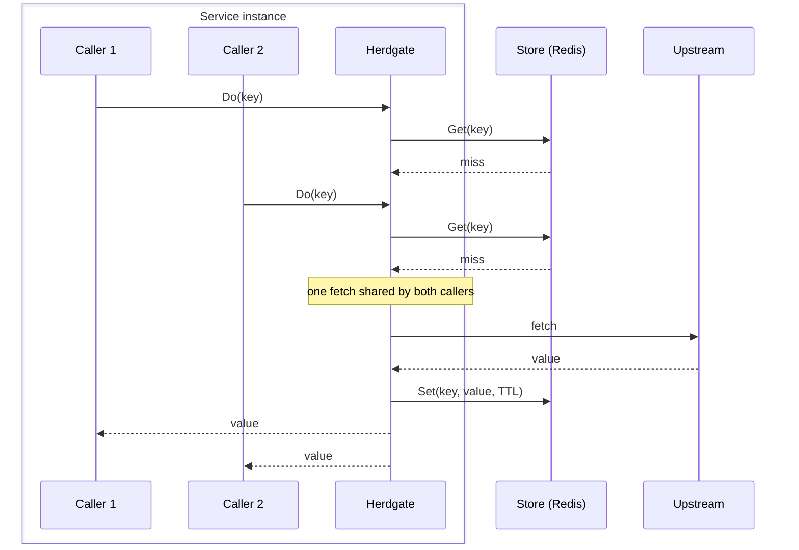
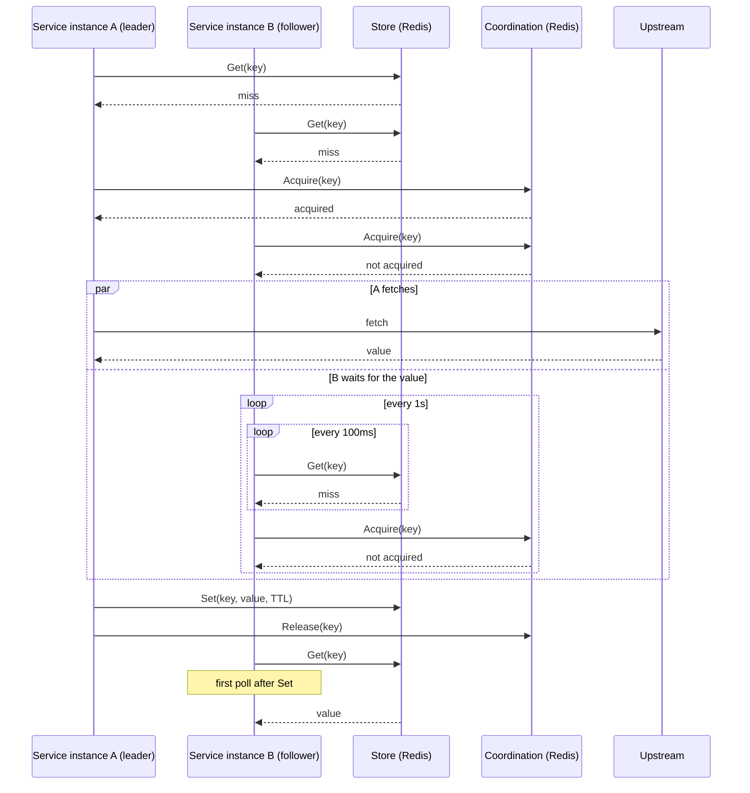

# Herdgate

[](https://github.com/giufi/herdgate/actions/workflows/ci.yml)

Herdgate is a Go library designed to mitigate thundering herds, including cache stampedes, in distributed systems, by coalescing operations (e.g., external API calls) linked to the same key.

> **Status:** Herdgate is still a work in progress. No releases have been published yet and the public interface may change.

## Problem

A thundering herd occurs when an event triggers a sudden surge of concurrent attempts to access the same shared resource, inducing resource contention and performance degradation. It is called a cache stampede when the triggering event is a cache miss.

When dealing with distributed systems, a thundering herd can have various triggering events (such as cache expiration, simultaneous service instance restarts, synchronized schedules), and causes multiple concurrent operations on an upstream dependency (e.g., DB queries).

Herdgate targets distributed thundering herds where each operation can be identified by a key and its result can be shared among all the callers.

## Results

A benchmark simulating a cache stampede scenario was performed locally via Docker Desktop, with different modes in order to evaluate Herdgate's impact:

- ungated mode: no Herdgate usage, with every caller performing a cache lookup and, on a miss, retrieving the value from the upstream and caching it
- singleflight mode: one Herdgate per service instance, each coalescing the fetches of its concurrent callers (see [Local coalescing first](#local-coalescing-first))
- coordination mode: singleflight plus Redis-backed Coordination, where one Herdgate fetches under a lease while the others wait for the cached value (see [Lease-based coordination with TTL and heartbeats](#lease-based-coordination-with-ttl-and-heartbeats))

Each benchmark run recreated 300 cache stampede occurrences (i.e., trials). Each cache stampede involved 20 simulated service instances, running in a single process, with 100 concurrent callers per service instance performing the same operation: cache lookup for the same key, value retrieval from a simulated constrained upstream on a cache miss and value caching.

The simulated upstream handled only 10 requests at the same time (median latency 400ms, 3s at most): each request waited up to 100ms for a free slot before being rejected. A Redis instance running in a Docker container was used for caching and, in coordination mode, for leases.

Key benchmark results:

- ungated mode: 2000 upstream requests per trial (one per caller), with 99.5% failed callers due to the upstream being constrained
- singleflight mode: a median of 20 upstream requests per trial (one per service instance), with 49% failed callers
- coordination mode: a median of 1 upstream request per trial (at most 2), with 0 failed callers

Full benchmark results can be reviewed in [this folder](bench/results/2026-11-09-mode-comparison). Each run has a summary with the exact command used to reproduce it, and a CSV with one row per trial.

Other benchmark runs were performed as well, varying the number of simulated service instances (1, 5, 10, 15 and 25), with 300 trials each, in singleflight and coordination modes.

Singleflight upstream requests per trial grew with the number of service instances, and, with the same upstream limit, failed callers appeared from 15 service instances on. Coordination stayed at a median of 1 request per trial (at most 2) with no failed callers.

These runs, in the same format, can be reviewed in [this folder](bench/results/2026-11-09-instance-scaling).

> **Not included yet:** failure scenarios (e.g., Redis down), caller latency and Redis load measurements, simulated service instances running in separate processes.

## Getting started

Required:

- Go 1.26+
- Redis client with `ContextTimeoutEnabled: true` and socket timeouts enabled, when using `redisstore` or `rediscoord`

Create, via a `Provider`, a new Herdgate with a Redis-backed Store and Coordination, which can use different Redis clients if needed.

```go
provider := herdgate.NewProvider()

hg := provider.New(
    redisstore.New(redisClient),
    herdgate.WithCoordination(rediscoord.New(redisClient)),
)
```

> Coordination is optional: without `herdgate.WithCoordination`, fetches are only coalesced locally via singleflight.

Use the new Herdgate to retrieve a value with a custom fetch function.

```go
quote, err := hg.Do(ctx, "quote:VWCE", herdgate.DoOptions{TTL: 10 * time.Second},
    func(ctx context.Context) ([]byte, error) {
        return fetchQuote(ctx, "VWCE")
    })
if err != nil {
    return err
}
```

Call `hg.Close(ctx)` at shutdown. It stops admitting new fetches and waits for those in flight.

## How Herdgate works

### Singleflight

Two callers request the same key through the same Herdgate, in a service instance.



### Coordination

Two service instances request the same key, with Coordination enabled.



## Design decisions

### Local coalescing first

**Decision**

Each Herdgate performs local coalescing with a dedicated `singleflight.Group` before attempting distributed coordination.

**Rejected alternative**

Relying only on lease-based coordination, without any local coalescing, would move the herd from the upstream dependency to the lease provider (e.g., Redis).

**Consequences**

Local coalescing stops at the Herdgate boundary. Without Coordination, multiple Herdgates, created in a single service instance or in multiple ones and requesting the same key, perform separate fetches.

### Lease-based coordination with TTL and heartbeats

**Decision**

Distributed coordination acts as a second coalescing layer, using a lease with TTL renewal through heartbeats. Only the lease holder fetches, while the others wait up to a fixed timeout, periodically checking if the value was cached and if they can acquire the lease.

**Consequences**

Coordination is best-effort. A lease may be lost even if the holder is still performing the fetch (e.g., Redis failover), which can cause duplicate fetches and stale cache writes from an older fetch.

### Depend on Store and Coordination interfaces

**Decision**

Herdgate depends on the `Store` and `Coordination` interfaces, decoupling their implementations.

**Rejected alternative**

Using specific (e.g., Redis-backed only) implementations for storage and coordination was rejected, in order to allow the selection of the most appropriate implementation for each use case.

**Consequences**

- Custom implementations can be provided when existing ones are not suitable.
- New or updated implementations do not affect Herdgate, as long as they honor the interface contract.
- Multiple implementations add maintenance effort.

### Coalesced fetches outlive caller cancellation

**Decision**

A coalesced fetch runs under `context.WithoutCancel`.
Canceling a caller's context, including the first one, has no impact on the other callers and ends only its own wait.

**Rejected alternative**

Using the first caller's context in the coalesced fetch would terminate the fetch for all callers when that context is canceled.

**Consequences**

- The coalesced fetch inherits the first caller's context values and uses a fixed timeout.
- A fetch ignoring its context can block coalesced callers and delay `Close` until its context expires.

### Best-effort Store and Coordination calls, bounded by deadlines

**Decision**

Store and Coordination calls are best-effort. Failures are bypassed or ignored instead of being returned as errors, allowing the caller to still get the fetched value.
Each call runs under an internal deadline (1s for most calls, 500ms for lease renewals).

**Rejected alternative**

Returning an error on Store and Coordination failures would make them hard dependencies and would prevent the library from being resilient to failures.

**Consequences**

- Each Store or Coordination call can add up to one second of latency to the caller.
- When Store or Coordination calls fail, they are bypassed or ignored, possibly causing duplicate fetches.

## Limitations

Herdgate coalesces fetches among callers requesting the same key, so it is not suitable for operations that must execute independently for every caller. A fetch may occasionally run more than once, so fetch functions must be idempotent.

Coordination trades extra Store and lease calls for fewer upstream requests. It pays off when multiple service instances request the same key, especially when the upstream is expensive or constrained.

### Coordination guarantees

Distributed coordination is best-effort.

A lease holder keeps fetching even after losing the lease. Thus, another caller can acquire it and start a second fetch. The first fetch can still finish later and overwrite a newer value with an older one.

Herdgate reduces duplicate work but does not provide fencing or strong consistency guarantees.

### Failure handling

Store and Coordination failures are treated as degraded operations rather than fatal errors. During Store or Coordination outages, failing calls are bypassed or ignored and callers fetch directly: duplicate fetches may occur.

Fetch functions are expected to honor their context. A fetch that ignores its context can block coalesced callers and delay `Close` until its context expires. With Coordination enabled, callers waiting on the lease give up after a fixed timeout and fetch on their own.

### Caching behavior

Herdgate does not provide negative caching, early refresh or TTL jitter.

When a cached value expires, the next request fetches the new value from the upstream, and a fetch error reaches all coalesced callers.

Internal timeouts are currently fixed and cannot be configured: 30s for a fetch, 1s for Store and lease calls (500ms for lease renewals), and about 32s for followers waiting on a lease.

## Metrics

Herdgate exposes Prometheus metrics through its `Provider`. Metric registration is opt-in: a `prometheus.Registerer` can be passed to the `Provider`, or `provider.Metrics()` can be registered manually.

```go
registry := prometheus.NewRegistry()
provider := herdgate.NewProvider(herdgate.WithRegisterer(registry))
```

Metrics are shared between Herdgates created by the same `Provider`.

Use one `Provider` per `Registerer`: registering two `Provider`s on the same one fails (`WithRegisterer` panics).

The metrics cover:

- Store operations and duration, by operation and result
- Coordination operations and duration, by operation and result
- fetch call duration, by result
- coalesced callers that waited for an in-flight fetch

## Roadmap

Areas under consideration include:

- follower wake-ups through the existing Redis Pub/Sub `Broadcast` implementation, which Herdgate does not use yet, keeping `Store` polling as fallback
- configurable timings (e.g., fetch timeout)
- broader benchmark coverage and improvements
- additional `Store`, `Coordination` and `Broadcast` implementations
